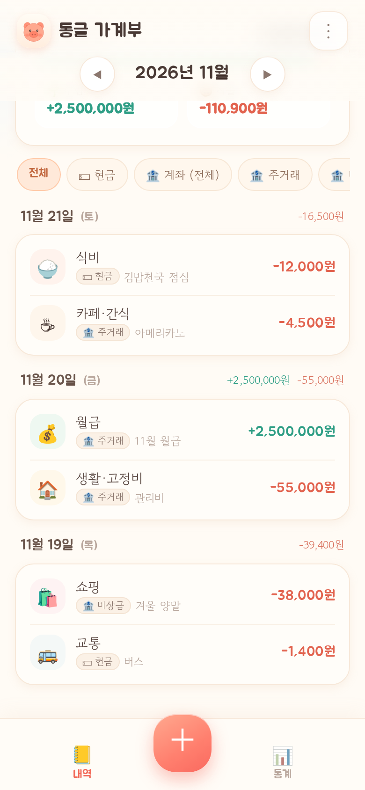
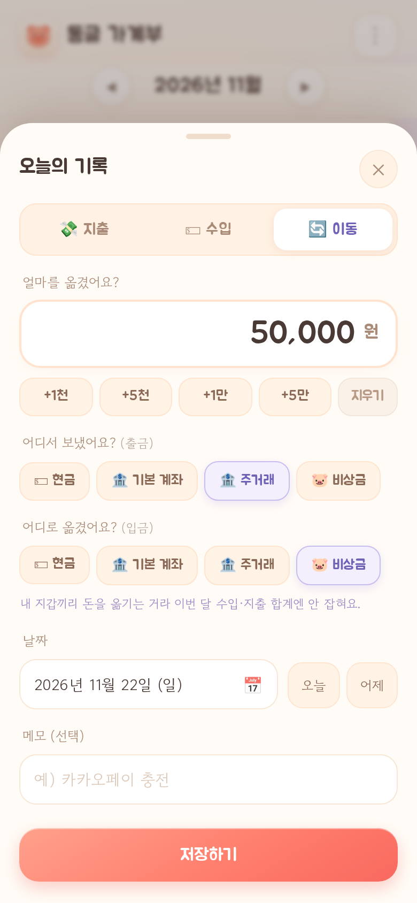
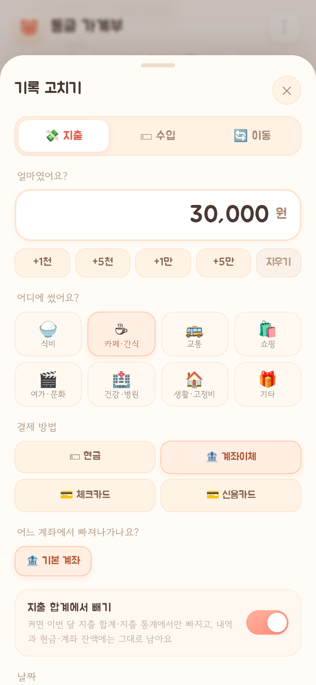
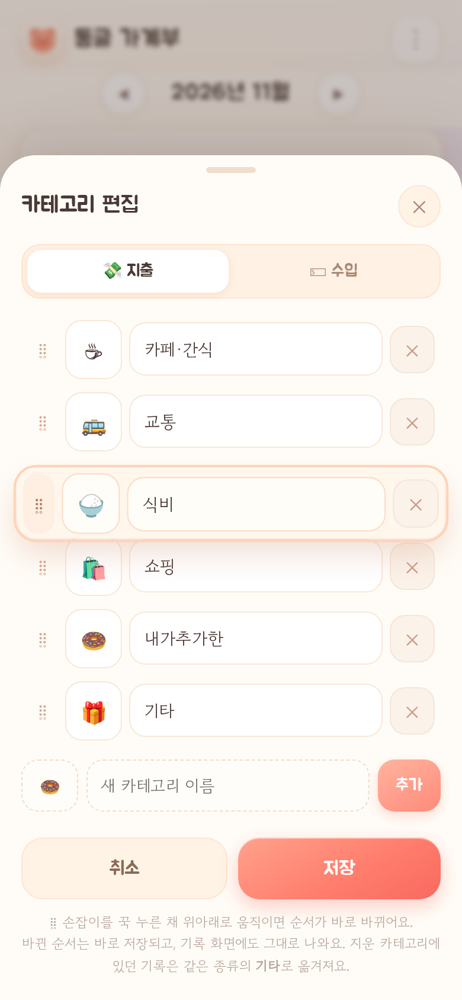

# 🐷 동글 가계부

동글동글 귀여운 **수입·지출 가계부** 웹앱입니다. **💵 현금**과 **🏦 계좌**(큰 카테고리 안에 국민은행·비상금 같은 세부 계좌를 원하는 만큼)로 나눠 관리하고, 지출은 **💵 현금 · 🏦 계좌이체 · 💳 체크카드 · 💳 신용카드** 네 가지 방법으로 적을 수 있어요. **🔄 이동**으로 내 지갑끼리 돈을 옮길 수도 있고, 계좌마다 **전체 현재 잔액에 포함** 스위치를 꺼서 비상금·모임통장처럼 재산에서 빼고 볼 수도 있어요. 지금 가진 돈을 한눈에 볼 수 있고, 폰에서 앱처럼 열 수 있으며(PWA), 기록은 그 기기의 브라우저(`localStorage`)에만 저장됩니다.

## 파일 구성

| 파일 | 설명 |
| --- | --- |
| `index.html` | 앱 전체 (HTML·CSS·JS 한 파일, 외부 라이브러리 없음) |
| `manifest.webmanifest` | 홈 화면에 추가할 때 쓰는 앱 정보 |
| `icon.svg`, `icon-192.png`, `icon-512.png`, `icon-maskable-512.png` | 앱 아이콘 (돼지 얼굴) |
| `apple-touch-icon.png` | 아이폰 홈 화면 아이콘 |
| `preview-list.png` · `preview-add.png` · `preview-stats.png` · `preview-wallet.png` · `preview-transfer.png` · `preview-cat-order.png` · `preview-cat-drag.png` · `preview-exclude-expense.png` | 화면 미리보기 |

## 쓰는 법

- **현금·계좌 잔액 맞추기** — 맨 위 요약 카드에 **💰 전체 현재 잔액**이 크게 나오고, 그 아래에 두 축이 있어요.
  - **💵 현금** — 탭하면 지금 가진 현금을 그대로 적는 창이 열립니다.
  - **🏦 계좌** — 계좌 총합(재산 포함인 세부 계좌 잔액의 합)이 크게 보이고, 그 아래에 세부 계좌들이 들여쓰여 나옵니다.
  - **＋ 세부 항목 추가** 로 계좌 안에 `🏦 국민은행`, `🏦 카카오뱅크`, `👛 비상금`처럼 원하는 만큼 나눠 담을 수 있어요. 세부 항목을 탭하면 이름·이모지·지금 잔액을 고치거나 지울 수 있고, 지운 항목의 기록과 잔액은 다른 계좌로 합쳐집니다. (계좌는 하나 이상 남습니다.)
  - **재산에서 빼고 보기** — 현금·세부 계좌 고치기 창의 **전체 현재 잔액에 포함** 스위치를 끄면, 그 항목은 맨 위 **💰 전체 현재 잔액**과 **🏦 계좌** 총합에서 빠집니다. 항목 옆에는 연보라 **재산 제외** 태그가 붙고, 계좌 총합 밑에 `재산 제외 100,000원` 처럼 빠진 금액이 작게 표시돼요. 그 항목의 잔액 자체는 그대로 보이고, 그 계좌로 쓰고 받은 돈도 그 계좌 안에서만 오르내립니다. (기본값은 모두 포함 ✅)
  - **🔄 계좌 간 이동** — 현금을 계좌에 넣거나 계좌끼리 돈을 옮길 때는 기록 창에서 **🔄 이동** 을 고르고 **어디서 보냈어요?(출금)** · **어디로 옮겼어요?(입금)** 를 각각 누릅니다. 보낸 곳은 줄고 받은 곳은 늘어나지만, 내 돈이 자리만 옮긴 것이라 **이번 달 수입·지출 합계와 카테고리 통계에는 안 잡혀요**. 내역에는 연보라 `🔄 기본 계좌 → 💛 카카오페이` 배지와 `⇄ 50,000원` 으로 나옵니다. 같은 곳을 고르면 저장되지 않고 안내가 떠요.

    
  - 적은 잔액은 그 뒤로 생기는 수입·지출과 이동만큼 자동으로 늘고 줄어요.
  - 아래쪽에 **이번 달 남은 돈 · 수입 · 지출**과 수입/지출 비율 막대가 같이 나옵니다. 기록이 하나도 없는 달에는 막대가 **연한 회색**으로 비어 있어요.
- **기록하기** — 아래 가운데 **＋** 를 누르면 입력창이 올라옵니다.
  - 지출/수입/이동을 고르고 금액을 적습니다. `+1천` `+5천` `+1만` `+5만` 을 누르면 금액이 더해지고, `지우기` 로 0원부터 다시 쓸 수 있어요.
  - `🔄 이동` 은 위에서 설명한 대로 출금·입금 지갑을 고르고 저장해요. 같은 곳을 고르면 저장되지 않고 안내가 떠요.
  - 카테고리를 콕 누르고 **결제 방법**을 고릅니다 — `💵 현금` / `🏦 계좌이체` / `💳 체크카드` / `💳 신용카드`.
    - `🏦 계좌이체`·`💳 체크카드` 를 고르면 **어느 계좌에서 빠져나가나요?** 가 바로 아래에 나오고, 그 계좌 잔액에서 차감돼요. 세부 계좌가 하나뿐이면 자동으로 그 계좌가 잡혀요.
    - `💵 현금` 은 현금 잔액에서, `💳 신용카드` 는 **현금·계좌 잔액에서 바로 빠지지 않고** 이번 달 지출·카테고리 통계에만 잡혀요. (카드값을 낼 때 계좌이체로 한 번 더 적으면 그때 잔액이 줄어요.)
  - 수입은 지금처럼 **입금처**로 `💵 현금` 또는 `🏦 계좌 세부 항목` 을 고릅니다.
  - 날짜(`오늘`/`어제` 버튼 있음)와 한 줄 메모를 적고 **저장하기**.
  - **지출 합계에서 빼기** — 지출 기록 창의 **지출 합계에서 빼기** 스위치를 켜면, 그 기록은 내역과 현금·계좌 잔액에는 그대로 남고 **이번 달 지출 합계·이번 달 남은 돈·일별 소계·지출 통계**에서만 빠집니다. 모임 회비를 걷어 나중에 돌려받는 돈, 회사에서 따로 정산하는 비용처럼 "내 소비"가 아닌 지출에 쓰기 좋아요. 끈 상태가 기본이고, 내역에는 연보라 **합계 제외** 배지가 붙어요. 결제 방법이 `💵 현금`·`🏦 계좌이체`·`💳 체크카드` 면 합계에서 빠져도 잔액은 실제로 나간 만큼 줄어들고, `💳 신용카드` 는 원래대로 잔액에서 빠지지 않아요. 기록을 고칠 때 스위치 상태도 그대로 되살아나고, 켜고 끄면 합계가 바로 다시 계산돼요.

    
- **고치기·지우기** — 내역을 누르면 수정창이 열립니다. 결제 방법이나 계좌를 바꾸면 잔액도 그쪽으로 옮겨 계산돼요. **삭제** 를 누르면 아래에 잠깐 **되돌리기** 가 떠서 실수해도 살릴 수 있어요.
- **골라 보기** — 내역 위 **전체 / 💵 현금 / 🏦 계좌 (전체) / 💳 신용카드 / 세부 계좌** 칩으로 그 결제 방법·계좌의 기록만 모아 볼 수 있어요. (세부 계좌 칩은 두 개 이상일 때 나옵니다.) **🔄 이동** 기록은 보낸 곳·받은 곳 어느 쪽 계좌 필터에서든 같이 보여요. 내역 배지도 `💵 현금` · `🏦 계좌이체` · `💳 체크카드` · `💳 신용카드` 로 구분되고, 세부 계좌가 둘 이상이면 `🏦 계좌이체 · 주거래` · `💳 체크 · 주거래` 처럼 어느 계좌인지 함께 보여요.
- **월 이동** — 위쪽 `◀ 2026년 11월 ▶` 로 달을 넘기고, 다른 달을 보는 중에는 **이번 달** 칩으로 바로 돌아옵니다.
- **통계** — 아래 **통계** 탭에서 지출/수입을 카테고리별 도넛과 순위 막대로 봅니다. 금액과 비율(%)이 같이 나와요. 신용카드로 쓴 돈도 지출 합계·카테고리 통계에 그대로 들어가고, **🔄 이동**과 **지출 합계에서 빼기**를 켠 지출은 수입·지출 합계와 통계에서 빠집니다.
- **카테고리** — `⋮ → 카테고리 편집` 에서 이모지와 이름을 바꾸거나 새 카테고리를 만들 수 있습니다. 지운 카테고리에 있던 기록은 같은 종류의 **기타** 로 옮겨집니다.
  - **순서 바꾸기** — 카테고리 줄 왼쪽의 **⠿ 손잡이**를 꾹 누른 채 위아래로 움직이면, 그 줄이 살짝 떠오른 채 손가락(마우스)을 따라오고 다른 줄들이 자리를 비켜 줘요. 손을 떼는 순간 그 자리로 들어가며 **바로 저장**되고, 기록 창(＋)의 카테고리 버튼도 바뀐 순서를 그대로 따라요. (이름·이모지 수정과 달리 순서는 **저장**을 누르지 않아도 바로 반영됩니다 — **취소** 를 눌러도 순서는 남아요.) 이름·이모지 칸을 고치거나 ✕ 로 지울 때는 드래그가 끼어들지 않고, 카테고리가 많아 화면을 넘어가면 목록의 위/아래 끝으로 끌 때 저절로 스크롤돼요.

    

## 백업 (폰을 바꿀 때 꼭!)

`⋮` 메뉴에서

- **백업 내보내기** — `동글가계부-백업-YYYY-MM-DD.json` 파일로 저장됩니다. 기록·카테고리와 함께 **현금·계좌(큰 카테고리와 세부 항목)**, **계좌별 재산 포함 여부**, 기록마다의 **결제 방법·계좌**, **🔄 이동 기록**, **지출 합계 제외 여부**도 담겨요. 카카오톡 '나에게 보내기'나 드라이브에 보관해 두세요.
- **백업 불러오기** — 그 JSON 파일을 고르면 기록이 되살아납니다. (지금 기록은 백업 파일 내용으로 바뀝니다.) **예전 백업 파일도 그대로** 불러올 수 있고, 재산 포함 여부가 없던 백업은 모두 **포함**으로, 결제 방법이 없던 기록은 현금 지갑에서 빠진 기록이면 **💵 현금**, 그 밖의 계좌 기록은 **🏦 계좌이체** 로 읽힙니다. 그때 쓰던 지갑은 모두 **🏦 계좌 세부 항목**으로 들어옵니다(잔액·기록 그대로). 현금·계좌 기능이 없던 아주 예전 파일은 기록이 전부 계좌로 들어옵니다.
- **전체 초기화** — 모든 기록·카테고리·현금·계좌 설정을 지웁니다. 되돌릴 수 없어요.

> 기록은 서버로 가지 않고 **그 기기 브라우저 안에만** 저장됩니다. 브라우저 기록/사이트 데이터를 지우면 가계부도 함께 지워지니, 가끔 백업해 두는 게 안전해요.

## GitHub Pages 에 올리기

1. GitHub에서 `ming_budget` 이름으로 새 저장소를 만듭니다.
2. 이 폴더(`budget-app`) **안의 파일들**을 저장소 **루트**에 올립니다. (`index.html` 이 최상단에 오도록)
3. 저장소 → **Settings → Pages** → *Build and deployment* 에서 **Source: Deploy from a branch**, **Branch: main / (root)** 선택 후 저장.
4. 1~2분 뒤 `https://ming3113.github.io/ming_budget/` 로 열립니다.
5. **삼성 인터넷**: 주소를 연 뒤 오른쪽 아래 **≡ → 홈 화면에 추가**. **크롬**: 오른쪽 위 **⋮ → 홈 화면에 추가**.
6. 홈 화면 아이콘으로 열면 주소창 없이 앱처럼 뜹니다. (아이콘은 돼지 얼굴 🐷)

> 상대 경로만 쓰기 때문에 폴더를 하위 경로에 올려도(`.../ming-budget/budget-app/`) 그대로 동작합니다.

## 만든 방식

- 글씨체: Google Fonts **Jua**(제목·숫자) + **Gowun Dodum**(본문)
- 색: 크림·버터·연살구 배경에 연보라 포인트, 지출은 코랄핑크 / 수입은 민트·하늘색
- 저장 키: `ming.budget.v1` (1.2.0부터 지갑 항목마다 `group: 'cash' | 'bank'`가 붙고, 예전 데이터는 `id:'cash'`만 현금·나머지는 모두 계좌로 자동 편입 / 1.3.0부터 기록마다 `payMethod: 'cash' | 'transfer' | 'debit' | 'credit'`가 붙고, 없던 기록은 현금 지갑이면 `cash`·계좌 기록이면 `transfer`로 자동 전환 / 1.4.0부터 지갑마다 `includeInTotal`(없던 데이터는 `true`), 기록에 `type:'transfer'` + `fromWalletId`·`toWalletId` 추가 / 1.6.0부터 지출 기록마다 `excludeFromExpense`(없던 데이터는 `false`))
- 잔액 계산: `현재 잔액 = 처음 잔액 + 그 항목의 수입 − 그 항목의 지출 ± 그 항목으로 오간 이동`. 잔액을 직접 적으면 `처음 잔액 = 적은 잔액 − (수입 − 지출 + 이동)` 로 역산해 저장하고, `계좌 총합 = 계좌 세부 항목 중 재산 포함인 것의 잔액 합`, `전체 잔액 = 재산 포함인 현금 + 계좌 총합`(재산 제외 항목은 따로 표시). **신용카드 지출은 `walletId` 없이 저장되어 어느 잔액에서도 빠지지 않고**, 이번 달 지출 합계·카테고리 통계에만 들어갑니다. **이동은 잔액만 옮기고 수입·지출 합계에서는 빠집니다.** **지출 합계에서 빼기(`excludeFromExpense`)를 켠 지출은 잔액 계산에는 그대로 들어가고, 수입·지출 합계·일별 소계·지출 통계에서만 빠집니다.**
- 검증: Playwright(모바일 뷰포트 390×844)로 기존 기능 전부에 더해 — 현금 50,000·기본 계좌 1,000,000·카카오페이 100,000(재산 제외)일 때 **전체 현재 잔액 1,050,000원**·계좌 총합 1,000,000원·`재산 제외` 태그, 카카오페이로 10,000원 지출해도 전체 1,050,000원 유지·카카오페이만 90,000원, 스위치 OFF→ON으로 1,140,000원·다시 OFF로 1,050,000원, 현금도 제외 가능(1,000,000원), **기본 계좌 → 카카오페이 50,000원 이동 시 기본 계좌 950,000·카카오페이 150,000·이번 달 수입/지출 0원 유지**, 같은 곳끼리 이동 저장 차단, 이동 기록 고치기·지우기·새로고침 유지, 이동이 현금/계좌/신용카드 필터에 각각 맞게 보임, 통계 0원, 예전 데이터·예전 백업(필드 없음) 불러오기 호환, 백업에 `includeInTotal`·이동 기록 포함 및 재불러오기, 지갑 삭제 시 이동 기록 정리, 초기화, **카테고리 순서 드래그**(⠿ 손잡이를 140ms 꾹 누른 뒤 끌기·줄 여백을 280ms 길게 누른 뒤 끌기 모두 동작, 손잡이 짧은 탭은 그대로, 마우스·실제 터치(CDP) 양쪽에서 위/아래 한 칸·두 칸 이동, 놓는 즉시 `state.cats` 저장·새로고침 후 유지·기록 창 그리드 순서 반영, 지출/수입 따로, 취소해도 순서 유지, 이름칸을 꾹 눌러도 드래그 안 됨·이름 수정/삭제/추가 정상, 빠른 스와이프는 드래그로 안 잡힘, 카테고리 18개일 때 끝으로 끌면 자동 스크롤·스크롤된 상태에서도 정확히 이동, 드래그 중 ESC로 닫아도 오류 없음, 360px 뷰포트 가로 넘침 없음), 콘솔 에러 0건 확인
- 검증(1.6.0 지출 합계 제외): 모바일 뷰포트(390×844)에서 일반 지출 10,000원과 **지출 합계에서 빼기** 지출 30,000원(둘 다 계좌이체)을 기록해 월 지출 합계 10,000원·일별 소계 10,000원·통계 10,000원(카테고리 비율에서도 제외)·계좌 잔액은 40,000원 모두 차감·전체 잔액 1,010,000원·내역에 연보라 `합계 제외` 배지 1개, **현금·체크카드** 제외 지출도 잔액만 차감, **신용카드** 제외 지출은 잔액 미차감, 수정 창에서 스위치 ON 복원·끄면 지출 40,000원으로 복귀·다시 켜면 10,000원, 유형을 수입/이동으로 바꾸면 스위치 숨김, 새로고침 후 배지·값 유지(`excludeFromExpense:true` 3건 저장), 필드 없던 예전 데이터는 모두 포함으로 읽혀 지출 7,000원·이동 기록 그대로·통계 7,000원, 기록 유형·결제수단·카테고리 순서 등 기존 기능 무손상, 콘솔 에러 0건 확인
